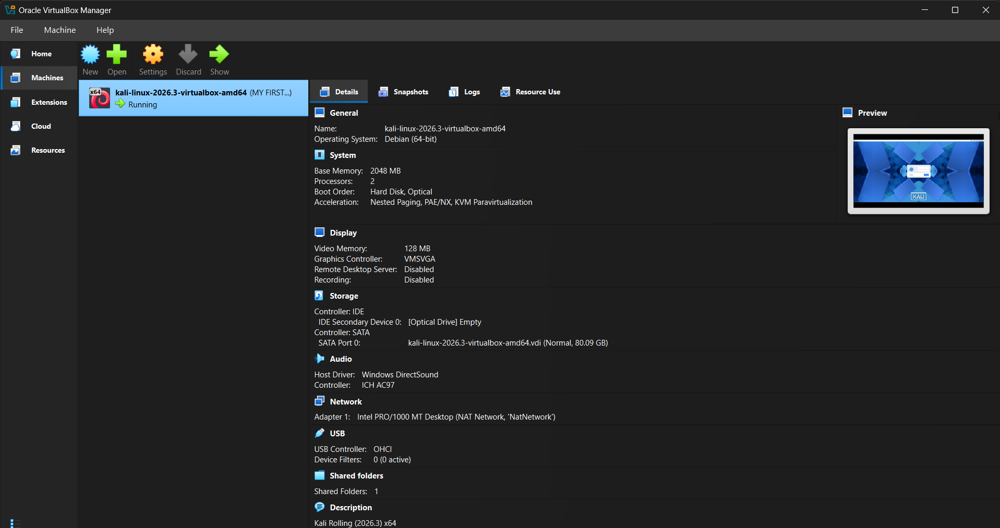
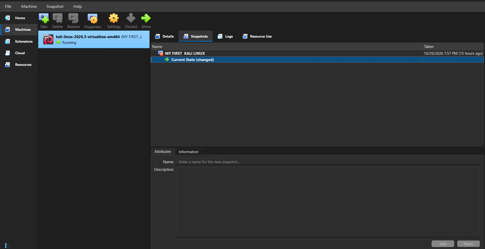
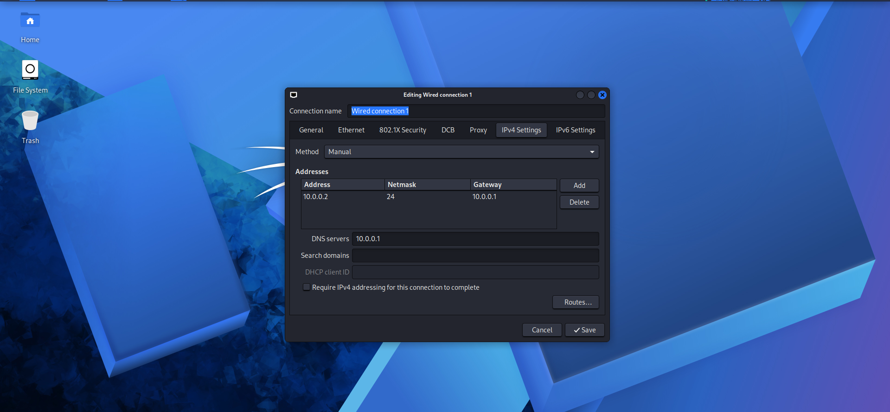
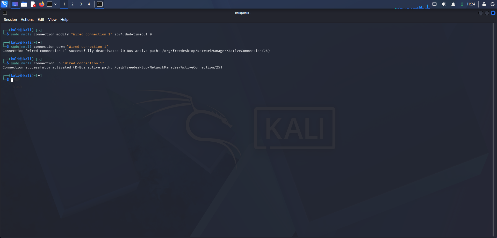
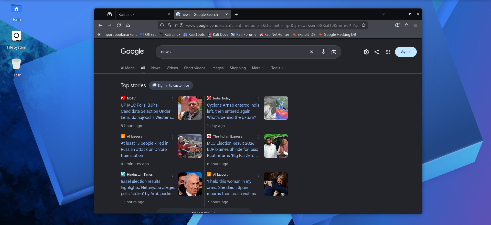

<div align="center">

# 🔐 Cybersecurity & Penetration Testing Lab Setup

### Networkwalks Cybersecurity Program · Batch B084 · Week 01

A practical lab documenting Kali Linux setup, VirtualBox networking, IPv4 configuration, NetworkManager connection management, and virtual-machine snapshot handling.


**Author:** K. Pranay Kumar

</div>

---

## 📌 Overview

This project documents the setup and configuration of a virtual cybersecurity lab using **Oracle VirtualBox** and **Kali Linux**. The objective is to prepare a controlled virtual environment for learning Linux networking fundamentals and practising cybersecurity techniques responsibly.

The repository includes screenshots of the Kali Linux environment, VirtualBox virtual-machine configuration, snapshot management, IPv4 settings, network-connection verification, and a browser session.

## 🎯 Objectives

- Set up and launch a Kali Linux virtual machine in Oracle VirtualBox.
- Review the virtual-machine configuration.
- Use a VirtualBox NAT Network for virtual lab networking.
- Configure and review IPv4 address, prefix, gateway, and DNS settings.
- Manage a network connection using NetworkManager (`nmcli`).
- Identify commands used to check network configuration and connectivity.
- Review VirtualBox snapshot management for recovery.
- Document the setup with labelled screenshots.

## 🧰 Tools and Technologies

| Tool / Technology | Purpose |
|---|---|
| Oracle VirtualBox | Runs the Kali Linux virtual machine |
| Kali Linux | Linux environment for cybersecurity learning |
| NetworkManager (`nmcli`) | Manages and reactivates network connections |
| VirtualBox NAT Network | Provides networking for connected virtual machines, depending on configuration |
| IPv4 | Addressing and routing configuration |

## 🏗️ Lab Architecture

```text
Host Computer
     |
Oracle VirtualBox
     |
Virtual Network (NAT Network)
     |
Kali Linux Virtual Machine
     |
IPv4 configuration and network checks
```

## ⚙️ Network Configuration

The following values are visible in the supplied network-configuration screenshot. They describe that example setup and may not match another computer or VirtualBox network.

| Setting | Value shown |
|---|---|
| IPv4 address | `10.0.0.2` |
| Prefix length | `/24` |
| Subnet mask | `255.255.255.0` |
| Gateway | `10.0.0.1` |
| DNS server | `10.0.0.1` |
| Connection name shown | `Wired connection 1` |

> **Important:** Confirm the subnet, gateway, and DNS settings in your own VirtualBox NAT Network before using these values. Do not copy them blindly into another network.

## 🪜 Work Documented

### 1. Kali Linux virtual machine

Kali Linux is shown in the virtual environment. The screenshots document the login screen and desktop environment.

### 2. VirtualBox configuration and snapshots

The screenshots show the virtual-machine configuration and the VirtualBox snapshot-management interface. A snapshot can provide a recovery point, but verify its state in VirtualBox before relying on it.

### 3. IPv4 network configuration

The network configuration screenshot shows a manual IPv4 address, prefix, gateway, and DNS server.

### 4. Network connection management

The terminal screenshot is associated with these NetworkManager commands:

```bash
sudo nmcli connection modify "Wired connection 1" ipv4.dad-timeout 0
sudo nmcli connection down "Wired connection 1"
sudo nmcli connection up "Wired connection 1"
```

A connection activation message confirms that the connection was brought up; it does **not by itself** prove internet access or successful DNS resolution.

## 🔎 Verification Commands

Run these commands in Kali Linux and review the actual output:

```bash
ip addr
ip route
ping -c 4 10.0.0.1
ping -c 4 1.1.1.1
getent hosts kali.org
nmcli connection show --active
```

- `ip addr` — displays interface addresses.
- `ip route` — displays routing information.
- `ping -c 4 10.0.0.1` — tests gateway reachability if ICMP is allowed.
- `ping -c 4 1.1.1.1` — tests external IP reachability if permitted.
- `getent hosts kali.org` — checks hostname resolution.
- `nmcli connection show --active` — lists active NetworkManager connections.

Network or firewall policies may block some checks. Only report a test as successful after checking its output. The screenshots currently in the repository should not be treated as proof that every verification command passed.

## 📸 Screenshots and Evidence

The images below use the **existing filenames in this repository**. Each screenshot has a title and a short description.

### 1. Kali Linux Login Page


*Shows the Kali Linux login screen before entering the desktop environment.*

### 2. VirtualBox VM Configuration



*Shows the virtual-machine configuration in Oracle VirtualBox.*

### 3. Kali Linux Snapshot Management



*Shows the VirtualBox snapshot-management view for the Kali Linux virtual machine.*

### 4. Kali Linux Desktop


*Shows the Kali Linux desktop environment after the virtual machine has started.*

### 5. Kali Linux Network Configuration



*Shows the manual IPv4 network settings, including address, prefix, gateway, and DNS.*

### 6. Network Connection Verification



*Shows terminal activity related to managing or verifying the network connection. Run the verification commands above and capture their results separately if you need evidence of connectivity and DNS tests.*

### 7. Kali Linux Firefox Browser



*Shows Firefox running inside Kali Linux. This is general desktop evidence, not proof of successful network configuration.*

## 💡 Learning Outcomes

Through this lab, I practised and explored:

- Working with a virtual machine in Oracle VirtualBox.
- Understanding the purpose of a NAT Network in a virtual lab.
- Reviewing IPv4 addresses, prefixes, gateways, and DNS settings.
- Managing a network connection using `nmcli`.
- Identifying commands for checking routes, connectivity, and DNS.
- Understanding how snapshots can help restore a virtual machine to a known state.
- Organising screenshots and documenting technical work.

## 🛡️ Safe and Responsible Use

This lab is intended for educational purposes and authorised testing. Only test systems and networks that you own or have explicit permission to assess. Keep cybersecurity practice within your own controlled lab or another explicitly authorised environment.

## 📁 Project Structure

The following structure matches the files currently included in the supplied repository archive. The screenshots are in the **repository root**, not in a `screenshots/` subfolder.

```text
NETWORKWALKS-B084-WK1-PM1-PRANAY-KUMAR/
├── Readme.md
├── 01-Screenshot-Kali Linux Login Page.png
├── 02-Screenshot-virtualbox-vm-configuration.png
├── 03-Screenshot-kali-linux-snapshot-management.png
├── 04-Screenshot-kali linux.png
├── 05-Screenshot-kali-linux-network-configuration.png
├── 06-Screenshot-network-connection-verification.png
└── 07-Screenshot-kali-linux-firefox-browser.png.png
```

## 🔗 Tools and Resources

- [Oracle VirtualBox Downloads](https://www.virtualbox.org/wiki/Downloads)
- [Kali Linux Downloads](https://www.kali.org/get-kali/)

## 🙏 Acknowledgement

Thank you to **Waqas Karim (CCIE)** and the **Networkwalks team** for their guidance and support as part of the Cybersecurity Program, Batch B084.

---

<div align="center">

**K. Pranay Kumar · Networkwalks · Batch B084 · Week 01**

</div>
